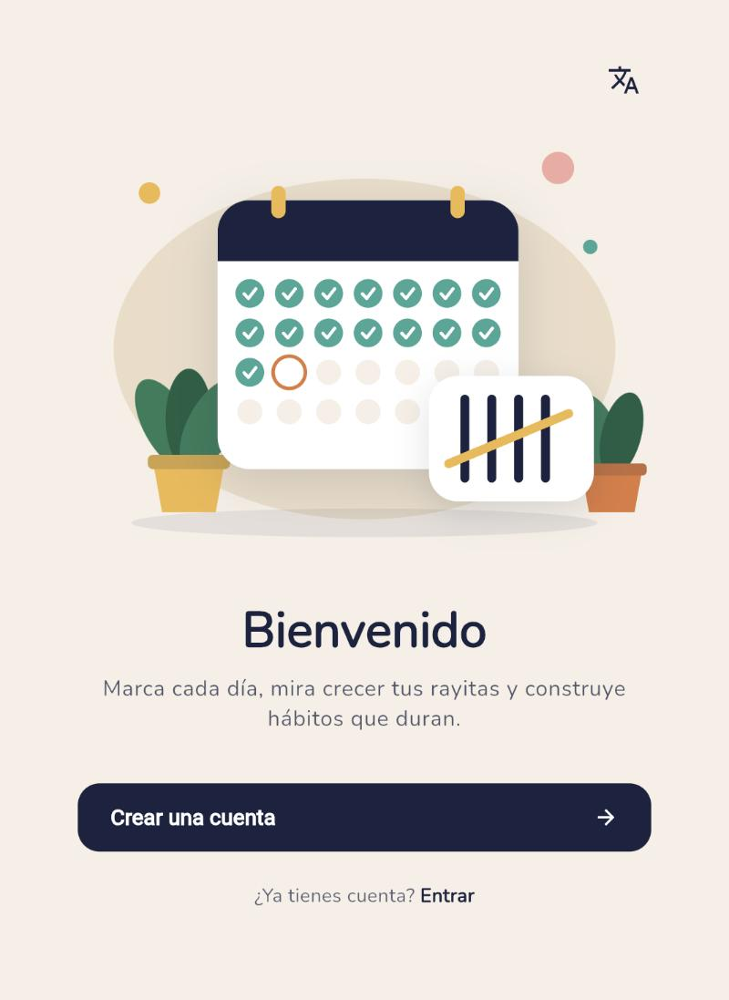
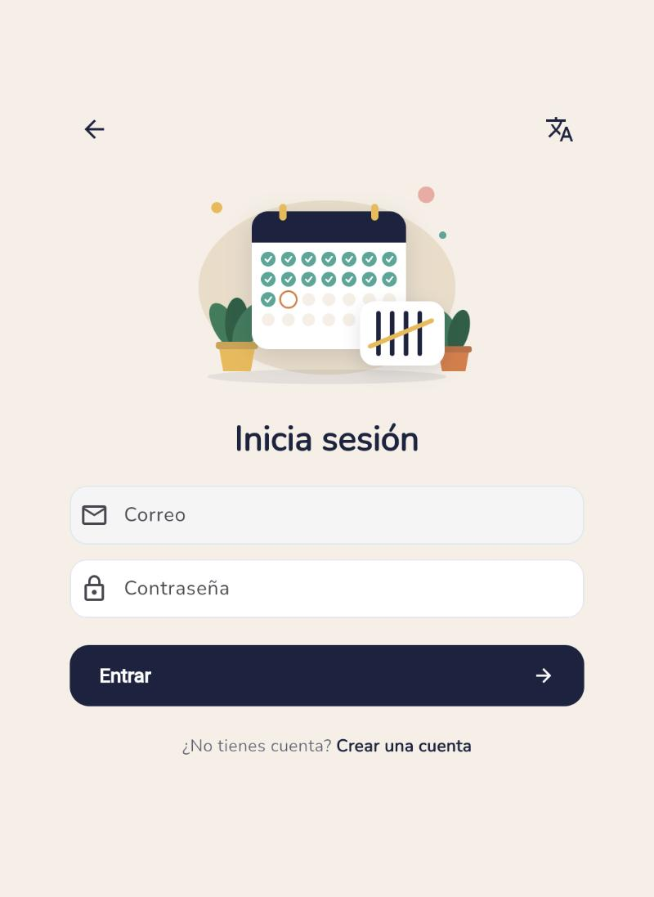
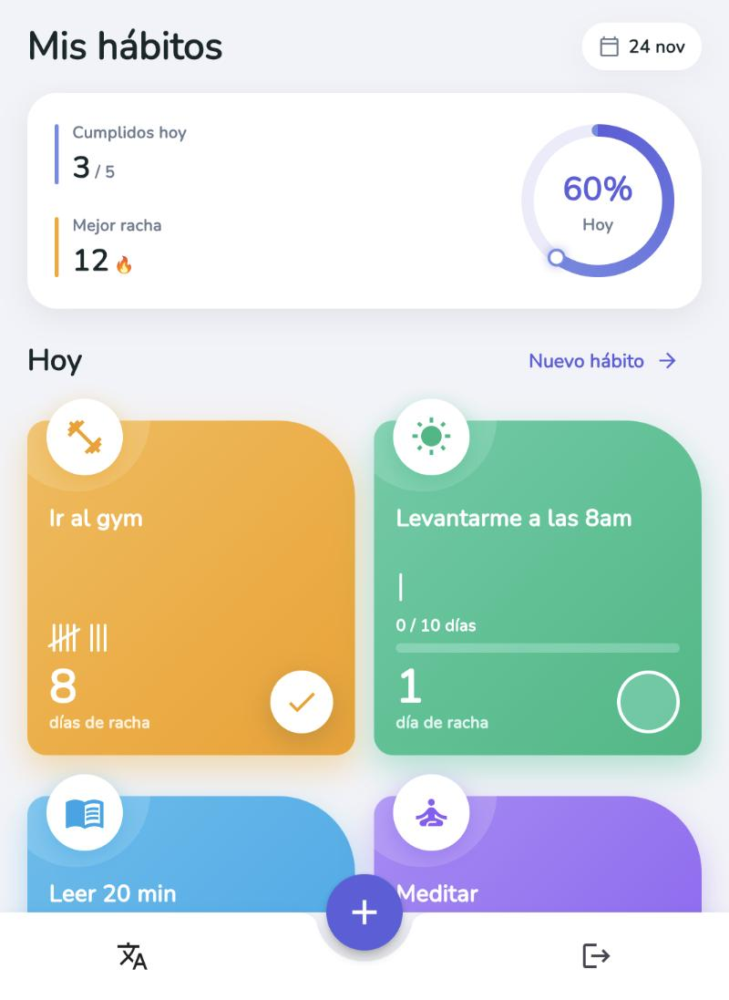
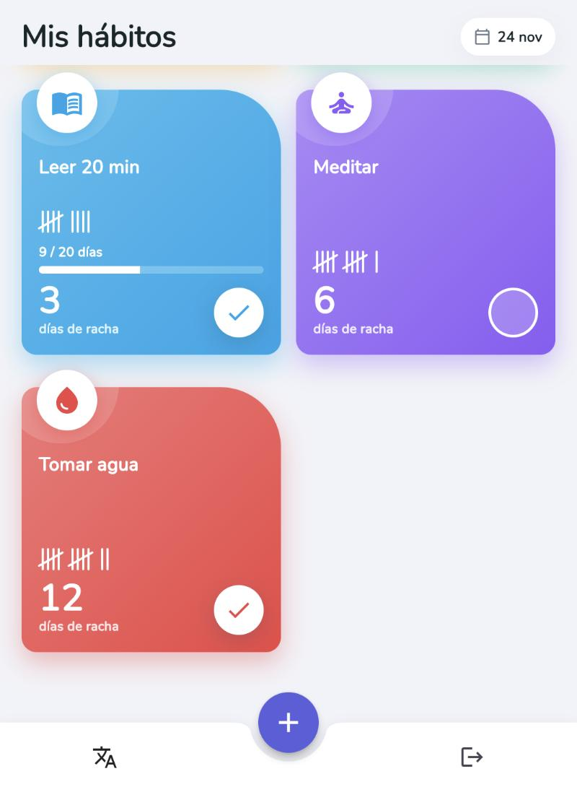
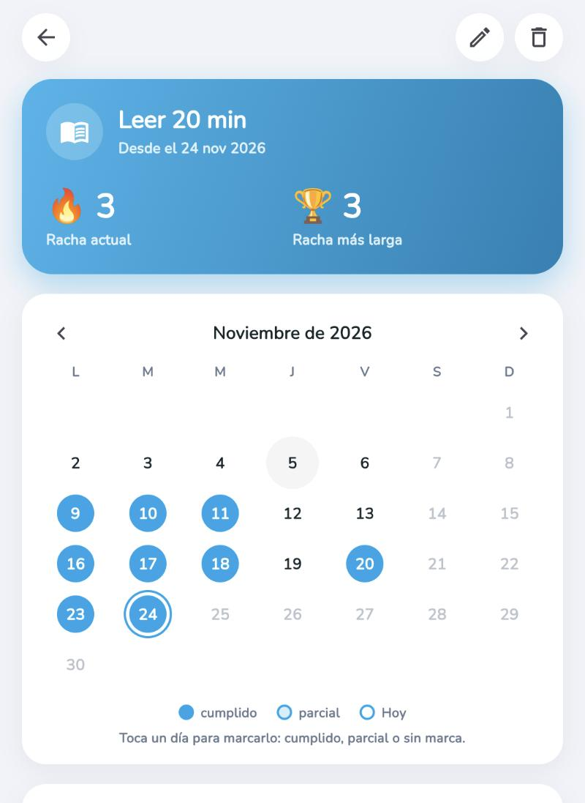
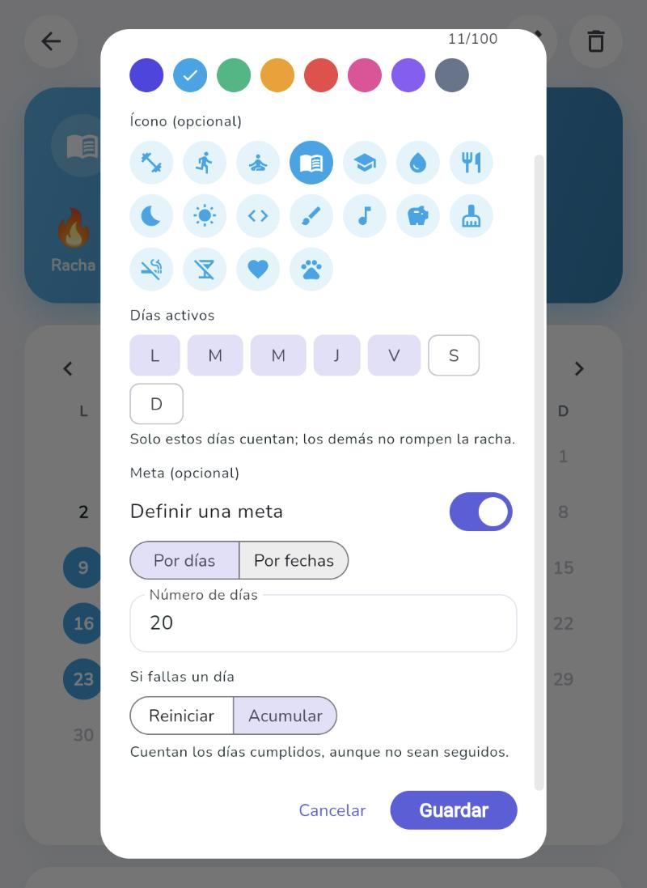

# Rayita

[github.com/alanbazan0/rayita](https://github.com/alanbazan0/rayita)

Rastreador de hábitos con **calendario**, **rachas** y **conteo con palitos** (las rayitas
tachadas de a cinco). Marca cada día como cumplido o parcial, mira crecer tus marcas y
ponle una meta a cada hábito, por ejemplo *"No fumar durante 10 días"*.

Tiene una API en Laravel y una **app móvil en Flutter para Android e iOS**, en español e
inglés (se elige solo según el idioma del sistema y se puede cambiar en la app). La versión
web de Flutter es para pruebas: se publica, pero sin difundir el enlace a los usuarios.

## Capturas

<table>
  <tr>
    <td align="center"><br><sub>Bienvenida</sub></td>
    <td align="center"><br><sub>Inicio de sesión</sub></td>
    <td align="center"><br><sub>Resumen del día</sub></td>
  </tr>
  <tr>
    <td align="center"><br><sub>Tarjetas con rachas, palitos y metas</sub></td>
    <td align="center"><br><sub>Detalle con calendario mensual</sub></td>
    <td align="center"><br><sub>Editor: ícono, días activos y meta</sub></td>
  </tr>
</table>

> Las capturas usan datos de ejemplo de una cuenta de prueba local.

## Qué puede hacer

- **Hábitos** con nombre, color e ícono (18 íconos para elegir).
- **Marcas diarias**: toca un día del calendario para alternar *sin marca → cumplido → parcial*.
  Solo "cumplido" cuenta para rachas y palitos.
- **Rachas**: racha actual y más larga. La actual sigue viva si el último día cumplido fue ayer.
- **Conteo con palitos**: cuatro rayas y la tachada del quinto, por mes y en total.
- **Metas opcionales**:
  - *por días* (N días desde hoy) o *por fechas* (un rango; los días se calculan solos);
  - *si fallas un día*: **reiniciar** (vuelve a 0) o **acumular** (cuentan los días cumplidos aunque no sean seguidos);
  - barra de avance, "faltan N días" y estado *lograda / no lograda*.
- **Días activos** por hábito (por ejemplo solo de lunes a viernes). Un día inactivo no se puede
  marcar, no rompe la racha y no cuenta para la meta.
- **Cuenta de usuario** con registro, confirmación de contraseña y **verificación de correo con
  código de 6 dígitos** (vence en 15 minutos, 5 intentos, reenvío cada 60 s).
- **Idiomas**: español e inglés, tanto en la app como en los mensajes de la API.

## Tecnologías

| Parte | Stack |
| --- | --- |
| API (`backend/`) | Laravel 13, PHP 8.3, Sanctum (tokens Bearer), SQLite en local / MySQL en producción, PHPUnit |
| App (`app/`) | Flutter 3, Riverpod, Dio, `flutter_secure_storage`, `intl` / gen-l10n |

## Estructura

```
rayita/
├── backend/   API Laravel (modelos, controladores, servicios, tests)
├── app/       App Flutter (lib/core, lib/screens, lib/widgets, lib/l10n, test)
├── deploy/    extract.php (servidor) y set-github-secrets.sh
├── .github/   Workflows de despliegue (API, web y operación)
└── docs/      Capturas de pantalla y guía de despliegue
```

La lógica de negocio vive en servicios probados por separado:
`StreakCalculator`, `TallyCalculator`, `GoalCalculator` y `EmailVerificationService`.

## Puesta en marcha (local)

Necesitas PHP 8.3 + Composer y Flutter.

```bash
git clone https://github.com/alanbazan0/rayita.git
cd rayita
```

**1. API**

```bash
cd backend
composer install
cp .env.example .env
php artisan key:generate
touch database/database.sqlite
php artisan migrate
php artisan serve --host=localhost --port=8000
```

En local el correo no se envía: el código de verificación se escribe en
`backend/storage/logs/laravel.log` (`MAIL_MAILER=log`).

**Código de invitación (opcional).** Si defines `INVITE_CODE` en `backend/.env`, registrarse exige
ese código, en la web y en la app móvil por igual. La app consulta `GET /api/config` y solo muestra
el campo cuando hace falta. Déjalo vacío para registro abierto, por ejemplo al publicar la app para
todos. No afecta a quien ya tiene cuenta.

**2. App**

```bash
cd app
flutter pub get
flutter run                 # en un emulador o dispositivo Android / iOS
flutter run -d chrome       # opcional: vista previa rápida en el navegador (solo desarrollo)
```

La app apunta a `http://localhost:8000/api` (en el emulador de Android, `10.0.2.2`). Para
cambiarlo: `--dart-define=API_URL=https://tu-dominio/api`.

**Idiomas.** Los textos están en `app/lib/l10n/app_es.arb` y `app_en.arb`; tras editarlos corre
`flutter gen-l10n`. Los mensajes de la API están en `backend/lang/es.json` y `en.json`.

## Pruebas

```bash
cd backend && php artisan test     # 126 pruebas (unitarias y de funcionalidad)
cd app && flutter analyze && flutter test   # 67 pruebas
```

## API en resumen

Todas las rutas van bajo `/api`. Las marcadas con 🔒 necesitan `Authorization: Bearer <token>`
y un correo verificado.

| Método | Ruta | Para qué |
| --- | --- | --- |
| GET | `/config` | Ajustes públicos (si el registro pide código de invitación) |
| POST | `/register`, `/login` | Crear cuenta (con `invite_code` si se exige) e iniciar sesión (devuelve el token) |
| GET / POST | `/me`, `/logout` | Usuario actual y cerrar sesión |
| POST | `/email/verify`, `/email/resend` | Verificar el correo con el código / reenviarlo |
| 🔒 | `/habits` (`apiResource`) | Listar, crear, ver, editar y borrar hábitos |
| 🔒 GET | `/habits/{id}/stats` | Rachas, palitos y avance de la meta |
| 🔒 GET | `/logs?month=AAAA-MM` | Marcas del mes |
| 🔒 PUT / DELETE | `/habits/{id}/logs/{AAAA-MM-DD}` | Marcar o quitar un día |

El idioma de los mensajes se toma del encabezado `Accept-Language` (`es` por defecto).

## Estado y pendientes

- La app y la API funcionan completas en local.
- **Despliegue (listo, sin ejecutar todavía):** API y web de pruebas en subdominios de HostGator
  (`rayita_app/` y `rayita_api/`), por FTP con GitHub Actions o con `./deploy.sh`, y un
  `deploy.php` protegido por token para extraer, migrar y consultar logs sin SSH. Falta cargar los
  secretos y hacer el primer despliegue; la guía está en [docs/DEPLOYMENT.md](docs/DEPLOYMENT.md).
  La web no se indexa en buscadores. La app móvil se distribuirá por Google Play y App Store.
- **Correo en producción:** falta crear la cuenta de correo del hosting; sus datos van en los secretos `MAIL_*`.
- **Android e iOS:** las plataformas y los íconos están configurados, pero la interfaz solo se ha
  probado hasta ahora en el modo web de desarrollo; falta probarla en emuladores o dispositivos.
- Más adelante: sustituir correo y contraseña por inicio de sesión con Google.
